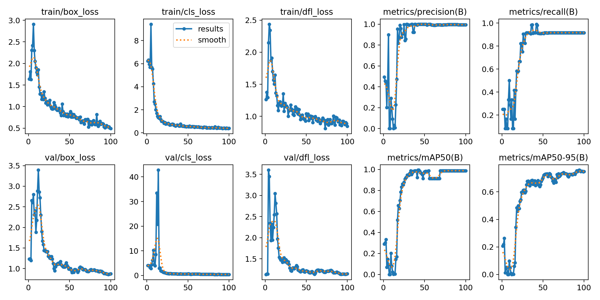

# Container Seal Detection

컨테이너 seal을 검출하는 1-class object detection 프로젝트입니다.

> **현재 상태: 데이터 준비 → 학습 → held-out test 평가 완료**
> 모든 데이터는 한 번의 촬영 세션에서 나왔습니다. 아래 수치는 이 데이터 범위 안에서의 결과입니다.

## 요약

- YOLO11n과 YOLO11s를 같은 조건에서 seed 3개씩 학습했습니다. 학습 전에 정한 기준(validation mAP50-95의 3-seed 평균)에 따라 **YOLO11n**을 선택했습니다.
  - validation mAP50-95: YOLO11n 0.7273 ± 0.0426, YOLO11s 0.6758 ± 0.0297
- 촬영 구도가 다른 원거리 장면으로 만든 held-out test에서는 **mAP50 0.540, mAP50-95 0.289, recall 0.500**이었습니다. validation보다 크게 낮습니다.
- 주요 실패 패턴은 false negative입니다. 가깝거나 사람이 들고 있는 seal은 대부분 검출했지만, 원거리에서 작게 보이는 고정된 seal은 자주 놓쳤습니다.
- 이 small-object failure를 본 뒤, 같은 weight로 추론 해상도만 1280으로 올린 **post-hoc 실험**을 했습니다. test recall은 0.500 → 0.981로 개선됐지만, validation recall은 0.917 → 0.729로 오히려 떨어졌습니다.
  - 그래서 1280을 일반적인 성능 개선으로 보지 않습니다. 해상도의 효과는 장면과 객체 크기에 따라 크게 달라지는 것으로 보입니다.
  - 공식 수치는 imgsz 640 결과입니다.

## 데이터셋

| 항목 | 내용 |
|---|---|
| 라벨링 | Roboflow (Auto Label + 수작업 검수), YOLO11 형식으로 export |
| 구성 | 한 번의 연속 촬영에서 추출한 프레임 105장 (frame 1–106, frame 101 없음) |
| 해상도 | 1920×1080 |
| 클래스 | 1개 (`container_seal`) |
| bounding box | 118개 |

데이터셋 원본(이미지, 라벨, ZIP)은 저장소에 포함하지 않았습니다. README에는 데이터 이미지 대신 학습 곡선 등 결과 그래프만 포함했습니다.

## 라벨링 과정

1. Roboflow의 Auto Label 기능으로 초기 bounding box를 생성했습니다.
2. 전체 이미지의 annotation을 직접 검수했습니다.
3. 검수하면서 잘못된 box를 고치고, 빠진 annotation을 추가했습니다.
4. YOLO11 형식으로 export했습니다 (v1).
5. v1 품질 점검(아래)에서 frame 28에 annotation이 빠진 것을 발견했고, 이를 수정해 v2를 만들었습니다.

## 데이터 품질 점검

1. **v1 export 점검**
   - 이미지와 라벨이 1:1로 대응하는지, YOLO 형식과 좌표 범위가 올바른지 확인했습니다. 오류는 없었습니다.
   - 빈 라벨 15장을 직접 확인해 아래처럼 분류했습니다.
     - 정상 negative: 12장
     - 라벨 누락 의심: 2장 (frame 13, 28)
     - 판단 보류: 1장 (frame 48)
2. **v2 export (라벨 수정)**
   - frame 28: 누락된 bounding box를 추가했습니다.
   - frame 13: seal이 손에 거의 가려져 bounding box 기준이 애매합니다. 그래서 라벨을 붙이지 않고 데이터셋에서 제외했습니다.
   - frame 48: 확인 결과 정상 negative로 유지했습니다.
   - v1과 비교해 라벨이 바뀐 것은 frame 28뿐이고, 이미지는 v1과 같습니다.

## 분할 전략

연속 촬영 프레임은 이웃한 프레임끼리 거의 같은 장면입니다. random split을 하면 train과 비슷한 이미지가 validation/test에 섞여 성능이 실제보다 높게 나옵니다. 그래서 **프레임 번호 구간 단위**로 나눴습니다.

- **test**: 촬영 구도가 바뀐 원거리 장면 전체(frame 79–100, 102–106, 27장)를 held-out test로 고정했습니다. frame 101은 원본에 없습니다.
- **validation**: 근접 장면(frame 1–76) 안에서 연속된 두 구간을 골랐습니다. 하나는 은색 seal이 나오는 25–30, 다른 하나는 파란 seal과 negative가 함께 있는 44–50입니다.
- **buffer**: train과 validation이 맞닿는 경계마다 1프레임씩 제외했습니다. 비슷한 프레임이 양쪽에 섞이는 것을 막기 위해서입니다.

| split | frame | 이미지 | bbox | empty label |
|---|---|---|---|---|
| train | 1–12, 14–23, 32–42, 52–76 | 58 | 46 | 12 |
| valid | 25–30, 44–50 | 13 | 12 | 1 |
| test | 79–100, 102–106 | 27 | 54 | 0 |
| excluded | 13, 24, 31, 43, 51, 77, 78 | 7 | 6 | – |

제외 이유는 다음과 같습니다.

| frame | 이유 |
|---|---|
| 13 | bounding box 기준이 애매해 라벨을 붙이지 않음 |
| 24, 31, 43, 51 | validation 경계 buffer |
| 77 | 카메라 구도 전환 중인 프레임 |
| 78 | 이미 test와 같은 원거리 구도라, train에 넣으면 test 장면이 학습에 섞임 |

## 학습 설정

모든 run은 아래 조건으로 학습했습니다. 이 값은 [scripts/train.py](scripts/train.py)에 고정되어 있고, 명령행에서는 모델·seed·device만 바꿀 수 있습니다.

| 항목 | 값 |
|---|---|
| 모델 | `yolo11n.pt`, `yolo11s.pt` (COCO pretrained) |
| imgsz | 640 |
| epochs | 100 |
| batch | 8 |
| patience (early stopping) | 30 |
| seed | 0, 1, 2 |
| deterministic | True |
| workers | 2 |
| augmentation, optimizer, learning rate | Ultralytics 기본값 (`optimizer=auto`) |
| best.pt 선택 기준 | validation mAP50-95 (Ultralytics 8.4.175의 fitness) |

실행 환경과 기록은 다음과 같습니다.

| 항목 | 값 |
|---|---|
| 환경 | Google Colab, Tesla T4 (6개 run 모두 동일) |
| 라이브러리 | Python 3.13.15, torch 2.11.0+cu130, ultralytics 8.4.175 |
| 코드 버전 | git commit `13fca2e` |
| 분할 식별값 | split_hash `6f8a98888a3b` |
| 원본 ZIP SHA-256 | `f5385864da63b899c271fa996f48b48692ba0a90ffb2fb86ea7ef336fb101520` |

- `split_hash`는 train/valid/test/excluded에 들어간 프레임 번호만으로 계산합니다. 그래서 OS와 관계없이, 같은 분할이면 같은 값이 나옵니다.
- 처음 Colab에서 한 번 학습했을 때는 split_hash가 로컬과 다르게 나왔습니다. 확인해 보니 분할 내용은 같았고, 기록 파일의 줄바꿈 문자(Windows CRLF / Linux LF) 차이 때문이었습니다. 그래서 hash 계산 방식을 고친 뒤, 그 run은 기록에서 폐기하고 수정된 코드로 6개 run을 다시 학습했습니다.

## 모델 선택 (validation)

### 선택 규칙 (학습 전에 정함)

1. YOLO11n과 YOLO11s를 같은 조건에서 각각 seed 0, 1, 2로 학습합니다.
2. validation mAP50-95의 3-seed 평균과 표준편차로 비교합니다.
3. 평균 차이가 seed 간 변동폭보다 작으면, 더 작은 YOLO11n을 선택합니다.
4. test set은 모델을 최종 선택한 뒤에만 평가합니다.

### 결과

validation은 13장(bbox 12개)입니다. 평균 ± 표준편차는 3개 seed의 표본 표준편차입니다.

| 모델 | seed | best epoch | Precision | Recall | mAP50 | mAP50-95 |
|---|---|---|---|---|---|---|
| YOLO11n | 0 | 74 | 1.0000 | 0.9089 | 0.9150 | 0.6783 |
| YOLO11n | 1 | 94 | 0.9948 | 0.9167 | 0.9888 | 0.7561 |
| YOLO11n | 2 | 37 | 1.0000 | 0.9091 | 0.9150 | 0.7474 |
| **YOLO11n** | **평균 ± 표준편차** | | **0.9983 ± 0.0030** | **0.9116 ± 0.0044** | **0.9396 ± 0.0426** | **0.7273 ± 0.0426** |
| YOLO11s | 0 | 69 | 1.0000 | 0.7442 | 0.8533 | 0.6452 |
| YOLO11s | 1 | 99 | 0.9193 | 0.9503 | 0.9758 | 0.7044 |
| YOLO11s | 2 | 79 | 0.9077 | 0.8202 | 0.8824 | 0.6778 |
| **YOLO11s** | **평균 ± 표준편차** | | **0.9423 ± 0.0503** | **0.8382 ± 0.1042** | **0.9038 ± 0.0640** | **0.6758 ± 0.0297** |

### 선택 과정

- **모델**
  - 주 기준인 validation mAP50-95의 3-seed 평균은 YOLO11n 0.7273, YOLO11s 0.6758로 YOLO11n이 더 높았습니다.
  - 다만 seed가 3개뿐이고 validation도 13장(bbox 12개)으로 작아서, 두 모델의 차이가 확실하다고 보기는 어렵습니다.
  - 이번 데이터에서는 YOLO11s가 더 낫다고 볼 근거가 없었으므로, 더 가벼운 **YOLO11n**을 선택했습니다. 선택 규칙의 어느 경우를 적용해도 결론은 같습니다.
- **test용 weight**
  - YOLO11n의 세 seed 중 validation mAP50-95가 가장 높은 **seed 1의 best.pt**(best epoch 94)를 최종 test 평가에 사용했습니다.
  - 이 weight의 validation mAP50-95 **0.7561은 3개 중 가장 높은 단일 run 값이라 낙관적인 수치**입니다. YOLO11n의 validation 성능은 3-seed 평균인 0.7273 ± 0.0426으로 보는 것이 적절합니다.



YOLO11n seed 1의 학습 결과입니다. validation mAP50-95 기준 best epoch는 94이고, 이 epoch의 best.pt를 최종 held-out test에 사용했습니다.

## Held-out test 결과

이 섹션의 imgsz 640 결과가 이 프로젝트의 **공식 held-out benchmark**입니다.

모델과 공식 평가 설정(imgsz 640)은 validation만으로 정했고, imgsz 640으로 평가한 held-out test 결과를 공식 benchmark로 유지했습니다. 이후 test failure를 확인한 뒤 같은 weight로 imgsz 1280을 post-hoc으로 추가 평가했지만, 이 결과는 모델 선택이나 공식 benchmark 갱신에 사용하지 않았습니다.

| 항목 | 값 |
|---|---|
| 모델 | YOLO11n seed 1, best.pt |
| test 데이터 | 27장, 54개 instance (원거리 장면, frame 79–100, 102–106) |
| Precision | 0.991 |
| Recall | 0.500 |
| mAP50 | 0.540 |
| mAP50-95 | 0.289 |
| 추론 속도 | 17.0 ms/image (Tesla T4) |

- validation(mAP50-95 0.7273 ± 0.0426)보다 test(0.289)가 크게 낮습니다.
- test는 처음부터 train/validation과 촬영 구도가 다른 장면으로 만들었습니다. 그래서 이 차이는 같은 장면 안의 성능과 새로운 장면에서의 성능 차이를 보여줍니다.
- 추론 속도는 Tesla T4 한 종류에서 잰 값입니다. 다른 GPU에서 잰 값과는 직접 비교할 수 없습니다.

## Failure analysis

test 예측 결과를 직접 확인한 내용입니다. 예측 이미지는 README에는 넣지 않았고, 대신 관찰한 실패 패턴을 텍스트로 정리했습니다.

**관찰한 내용**
- test 이미지에는 모두 container_seal이 2개씩 있습니다.
- 가까이 있거나 사람이 들고 있는 seal은 대부분 검출했습니다.
- 위쪽 구조물에 고정되어 있고 화면에서 작게 보이는 seal은 자주 놓쳤습니다.
- precision은 0.991인데 recall은 0.500입니다. 잘못 잡은 box(false positive)보다는 놓친 객체(false negative)가 주요 실패 패턴입니다.

**가능한 원인 (추정)**
- 원거리 장면에서 seal이 작게 보입니다.
- train 데이터는 근접 장면뿐이었습니다. 원거리 구도나 구조물에 고정된 seal은 학습 데이터에 없었습니다.
- 이 두 가지가 원인일 가능성이 있습니다. 다만 원인별로 따로 검증한 실험은 하지 않았으므로 확정할 수는 없습니다.

## Post-hoc high-resolution inference

> 이 실험은 test 결과와 failure pattern을 **본 뒤에** 설정을 고른 것입니다. 그래서 unbiased held-out benchmark가 아니라 사후(post-hoc) 실험으로만 기록합니다.

Failure analysis에서 "작게 보이는 seal을 놓친다"는 패턴을 확인했습니다. 그래서 작은 객체가 원인이라는 가설을 확인하려고, **모델 weight와 학습 설정은 그대로 두고** 같은 YOLO11n seed 1 best.pt로 **추론 해상도(imgsz)만 640에서 1280으로** 올려 test와 validation을 다시 평가했습니다. 모델은 imgsz 640으로 학습된 그대로입니다.

| 데이터 | 추론 imgsz | Precision | Recall | mAP50 | mAP50-95 | 구분 |
|---|---|---|---|---|---|---|
| validation (근접 장면, 13장) | 640 | 0.995 | 0.917 | 0.989 | 0.756 | 모델 선택에 사용한 값 |
| validation (근접 장면, 13장) | 1280 | 1.000 | 0.729 | 0.745 | 0.544 | post-hoc 실험 |
| test (원거리 장면, 27장) | 640 | 0.991 | 0.500 | 0.540 | 0.289 | **공식 held-out benchmark** |
| test (원거리 장면, 27장) | 1280 | 0.998 | 0.981 | 0.992 | 0.593 | post-hoc 실험 |

**해석**
- **원거리 test 장면**: recall이 0.500에서 0.981로 올랐고, precision은 0.99 수준을 유지했습니다. 640에서 놓치던 작은 seal 대부분을 1280에서는 검출했습니다.
- **근접 validation 장면**: 반대로 recall이 0.917에서 0.729로, mAP50-95가 0.756에서 0.544로 떨어졌습니다.
- 따라서 1280은 **일반적인 성능 개선이 아닙니다.** 입력 해상도의 효과는 장면과 객체 크기에 강하게 좌우되는 것으로 보입니다.
- **가능한 설명 (추정)**
  - 모델은 imgsz 640으로 학습됐습니다. 그래서 학습 때 본 seal 크기는 640으로 줄인 근접 장면 기준입니다(원본 기준 box 중앙값 약 95×244 px → 입력에서 약 32×81 px).
  - 1280으로 추론하면 원거리의 작은 seal은 이 크기에 가까워집니다. 반면 근접 장면의 seal은 학습 때보다 약 2배 커집니다.
  - 학습한 객체 크기 범위와 맞는 쪽은 좋아지고 벗어나는 쪽은 나빠졌을 가능성이 있습니다. 이 설명은 따로 검증하지 않았습니다.
- 작은 원거리 객체가 test의 주요 실패 원인이라는 가설을 **뒷받침하는 결과**입니다. 다만 다음 이유로 가설이 증명됐다고 보지는 않습니다.
  - 설정을 같은 test set의 결과를 보고 골랐으므로, test 1280 수치는 낙관적일 수 있습니다.
  - test는 한 장면(27장), validation은 13장뿐입니다. 다른 장면에서도 같은 경향이 나올지는 확인하지 않았습니다.

**trade-off**
- test 추론 시간이 17.0에서 23.8 ms/image로 약 40% 늘었습니다. 둘 다 Tesla T4에서 잰 값입니다.
- 해상도를 올리면 메모리 사용량도 늘어나므로, 실제로 쓸 장비에서 속도와 메모리를 따로 확인해야 합니다.

**운영 원칙**
- imgsz는 640과 1280 두 값만 확인했고, 추가적인 해상도 튜닝은 하지 않았습니다.
- 이 결과를 보고 test로 추가 모델 선택이나 hyperparameter 조정은 하지 않았습니다.
- 공식 held-out benchmark는 imgsz 640 결과로 유지합니다.
- 이 실험은 저장소 스크립트만으로는 재현되지 않습니다. [scripts/evaluate.py](scripts/evaluate.py)는 imgsz 640으로 고정되어 있고, test 평가를 한 번만 허용하기 때문입니다.

## 한계

- 모든 데이터가 한 번의 촬영 세션에서 나왔습니다. 다른 환경(조명, 컨테이너, 카메라)에서도 잘 동작할지는 이 데이터로 검증할 수 없습니다.
- validation이 13장(bbox 12개)으로 작아서, 평가 지표가 크게 흔들릴 수 있습니다. 모델 비교에 쓴 seed도 3개뿐입니다.
- test는 원거리 장면 하나뿐이라 장면 다양성이 부족합니다. test bbox 54개 중 27개는 장면에 고정된 같은 seal입니다.
- 원거리 구도는 train 데이터에 없었습니다.
- 최종 weight의 validation 수치(0.7561)는 seed 3개 중 최고값을 고른 영향으로 낙관적입니다.
- imgsz 1280 결과는 test를 본 뒤 고른 post-hoc 설정이라 일반화 성능의 근거로 쓸 수 없습니다. 근접 장면인 validation에서는 오히려 성능이 떨어졌습니다.

## 향후 계획

아래는 아직 하지 않은 작업이고, 효과도 검증되지 않았습니다.

- 원거리 장면, 구조물에 고정된 seal 등 장면 다양성을 늘린 데이터를 추가로 촬영하고 라벨링하기
- 근접과 원거리 장면을 모두 포함한 새 촬영 데이터에서 추론 해상도의 효과를 확인하기 (지금은 post-hoc 결과만 있고, 장면에 따라 효과가 반대로 나타남)
- 객체 크기가 달라져도 성능이 유지되는 방법 검토하기 (예: 근접·원거리 장면을 함께 학습하기, 고해상도로 학습하기, 이미지를 타일로 나눠 추론하기)

**평가 원칙**
- 이번 test set은 이미 결과를 확인했으므로, 개선한 모델의 평가나 선택에 다시 쓰지 않습니다.
- 개선 모델은 **새로 촬영한 별도 세션 데이터**를 test로 두고 평가합니다.

## 프로젝트 구조

```
container-seal-detection/
├── assets/
│   └── results.png          # YOLO11n seed 1 학습 곡선
├── configs/
│   └── data.example.yaml    # 데이터셋 설정 예시 (실제 data.yaml은 스크립트가 생성)
├── data/
│   ├── raw/                 # Roboflow export ZIP (Git 제외)
│   └── processed/           # 분할된 데이터셋 (Git 제외)
├── outputs/                 # 학습·평가 결과 (Git 제외)
├── requirements.txt         # ultralytics 버전 고정 (torch는 환경별 설치)
└── scripts/
    ├── split_dataset.py     # 프레임 기준 분할 + 검증
    ├── train.py             # 학습 1회 + validation 재평가 + 실험 기록
    ├── evaluate.py          # val/test 평가 (test는 --final 필요, 한 번만 허용)
    ├── predict.py           # 새 이미지 또는 이미지 폴더에 대한 inference
    └── common.py            # 경로, 실행 환경·데이터 hash 기록
```

## 재현 및 사용 방법

### 데이터 준비 · 학습 · 평가

1. Roboflow YOLO11 export ZIP을 `data/raw/robot-labeling.v2i.yolov11.zip`에 둡니다.
2. 분할 스크립트를 실행합니다. Python 표준 라이브러리만 사용합니다.

   ```bash
   python scripts/split_dataset.py
   ```

   - 원본 ZIP은 수정하지 않습니다. 결과는 `data/processed/container_seal_v2/`와 `configs/data.yaml`에 생성됩니다.
   - 실행 전에 아래 항목을 검증하고, 하나라도 맞지 않으면 파일을 만들지 않고 중단합니다.
     - 모든 프레임이 train/valid/test/excluded 중 정확히 한 곳에만 속하는지
     - 이미지와 라벨이 1:1로 대응하는지
     - YOLO 형식과 좌표 범위가 올바른지
   - 출력 폴더가 이미 있으면 덮어쓰지 않습니다. `--overwrite`를 붙이면 이 스크립트가 만든 출력만 교체합니다.
   - 원본 ZIP의 SHA-256을 출력하고 기록합니다. 위 학습 설정 표의 값과 같은지 확인하세요.
3. 의존성을 설치합니다. torch는 환경에 맞게 먼저 설치합니다 (Colab은 기본 설치된 CUDA torch 사용).

   ```bash
   pip install -r requirements.txt
   ```

4. 학습합니다. 모델 2개 × seed 3개, 총 6번 실행합니다.

   ```bash
   python scripts/train.py --model yolo11n --seed 0 --device 0
   python scripts/train.py --model yolo11s --seed 0 --device 0
   # seed 1, 2도 같은 방식으로 실행
   ```

   - 결과는 `outputs/runs/<model>_seed<seed>/`에 저장되고, `outputs/experiments.csv`에 한 줄씩 기록됩니다.
   - 기록 항목: validation 지표, git commit, split_hash, 원본 ZIP SHA-256, GPU 이름, 라이브러리 버전
   - `--smoke --device cpu`를 붙이면 동작 확인용으로 1 epoch만 실행합니다. 결과는 `outputs/smoke/`에 따로 저장됩니다.

5. 최종 모델을 validation 기준으로 정한 뒤에만 test를 평가합니다.

   ```bash
   python scripts/evaluate.py --weights outputs/runs/yolo11n_seed1/weights/best.pt --split test --final --device 0
   ```

   - `--final` 없이는 test 평가를 거부합니다.
   - `outputs/test_evaluation.csv`가 이미 있으면 다시 평가하지 않습니다.

### Google Colab에서 실행

실제 학습은 Google Colab(Tesla T4)에서 했습니다. 순서는 위 2~4단계와 같고, Colab 셀에서는 저장소 폴더로 이동한 뒤 아래처럼 실행합니다. 런타임은 GPU로 설정하고, v2 ZIP은 `data/raw/`에 업로드합니다.

```bash
!pip install -r requirements.txt
!python scripts/split_dataset.py
!for m in yolo11n yolo11s; do for s in 0 1 2; do python scripts/train.py --model $m --seed $s --device 0; done; done
```

Colab 세션이 끝나면 `outputs/`가 사라지므로, 결과는 따로 백업해야 합니다.

### Inference

[scripts/predict.py](scripts/predict.py)는 학습된 weight로 새 이미지에 예측을 실행하는 도구입니다. metric 평가나 모델 선택에는 쓰지 않습니다.

```bash
# 이미지 1장
python scripts/predict.py \
  --weights path/to/best.pt \
  --source path/to/image.jpg

# 이미지 폴더
python scripts/predict.py \
  --weights path/to/best.pt \
  --source path/to/images \
  --device cpu \
  --name example_run
```

| 옵션 | 설명 |
|---|---|
| `--weights` | 사용할 YOLO weight |
| `--source` | 이미지 1장 또는 이미지 폴더 |
| `--imgsz` | 기본 640 |
| `--conf` | 기본 0.25 |
| `--device` | 미지정 시 자동 선택 |
| `--name` | 출력 폴더 이름 |

- 결과는 `outputs/predictions/<run_name>/`에 저장됩니다. box를 그린 예측 이미지와 검출 결과 `.txt`가 함께 저장됩니다. 원본 이미지는 수정하지 않습니다.
- 모델 weight는 저장소에 포함하지 않습니다 (`.gitignore`에서 `*.pt` 제외). 직접 학습한 `best.pt`를 지정해야 합니다.
- held-out test 데이터를 `--source`로 지정하면 코드에서 실행을 막습니다.
- 동작은 1 epoch smoke weight와 validation 이미지 1장으로 확인했습니다. 예측 이미지와 결과 `.txt`가 저장되는 것까지 확인했습니다.

## 사용 도구

- [Ultralytics YOLO](https://github.com/ultralytics/ultralytics) 8.4.175 (AGPL-3.0)
- PyTorch
- Roboflow (라벨링, export)
