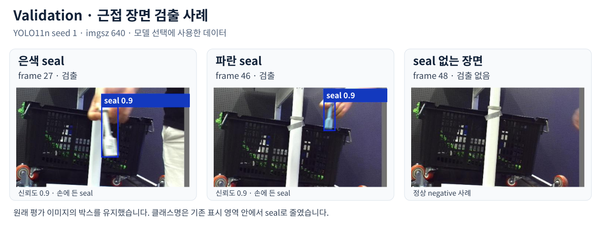
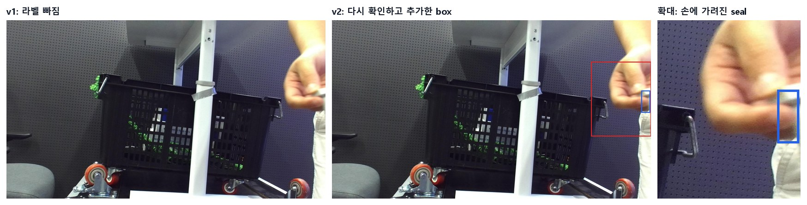
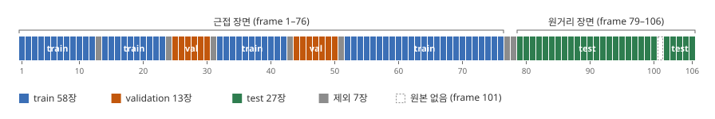
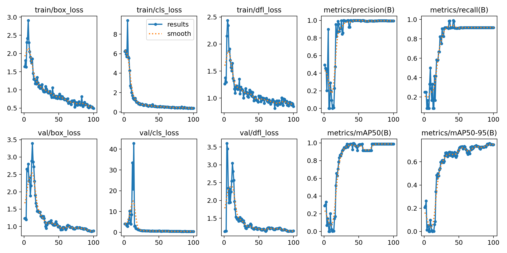
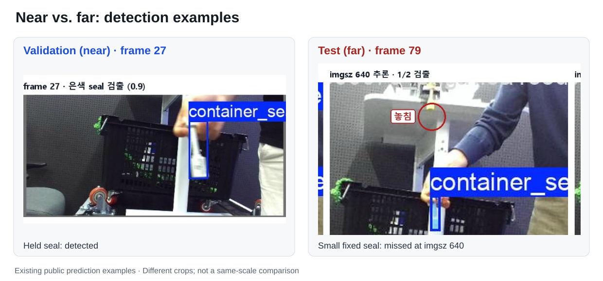
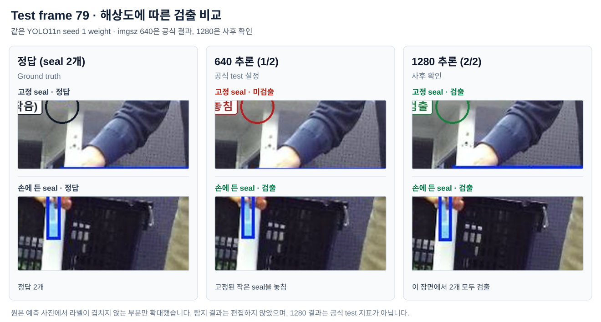

# Container Seal Detection (YOLO11)

[](https://github.com/slvrfivo/container-seal-detection/actions/workflows/tests.yml)

직접 찍은 영상에서 뽑은 프레임으로 컨테이너 seal 검출 모델(YOLO11)을 학습하고 평가한 프로젝트입니다. 모델 성능 자체보다는 연속 프레임이 train과 test에 섞이지 않게 나누는 것, 라벨을 꼼꼼히 확인하는 것, 새 구도에서 어디서 틀리는지 보는 데 시간을 많이 썼습니다.

실험 과정과 그래프는 [Notion 페이지](https://app.notion.com/p/3f797ecb382581e9a4c4d0877e21442a)에 더 자세히 정리했고, 실행 방법은 [아래](#재현-및-사용-방법)에 있습니다.

> 데이터는 모두 한 번의 촬영에서 나왔기 때문에, 아래 결과도 이 데이터 안에서의 결과입니다. 원본 이미지, 라벨, weight는 올리지 않았고, README에는 검출·라벨링 사례 이미지 네 장과 학습·분할 그래프 두 개만 넣었습니다.

## 결과 요약

| 항목 | 결과 |
|---|---|
| 데이터 | 원본 105장(box 118개) 중 라벨 기준이 애매한 프레임과 분할 경계 buffer 7장을 빼고 98장(box 112개)을 train·validation·test에 사용. 클래스 1개 (`container_seal`) |
| 분할 | 프레임 구간 단위로 나누고 경계에 buffer를 둠. 구도가 다른 장면은 test로 따로 둠 |
| 모델 비교 | YOLO11n, YOLO11s를 seed 0, 1, 2로 각각 학습 |
| validation mAP50-95 (3-seed 평균 ± 표준편차) | YOLO11n 0.727 ± 0.043, YOLO11s 0.676 ± 0.030 |
| 최종 모델 | YOLO11n seed 1 `best.pt` |
| held-out test (imgsz 640) | mAP50 0.540, mAP50-95 0.289, recall 0.500 |
| 주로 틀린 경우 | 원거리 장면에서 작게 보이는 seal을 놓침 |
| 1280 추론 (사후 확인) | 같은 weight로 test recall은 올랐지만 validation은 떨어짐. 공식 결과로 쓰지 않음 |



위 그림과 아래의 frame 79 비교 그림은 원본 JPG의 잘린 클래스명 표시만 짧게 덮어쓴 SVG입니다. 검출 박스·결과는 수정하지 않았고, 원본 JPG도 `assets/`에 그대로 남겨 두었습니다.

최종 모델(YOLO11n seed 1, imgsz 640)이 validation 근접 장면에서 검출한 예시입니다. 모델 선택에 쓴 데이터라 held-out 결과는 아닙니다. 은색 seal과 파란 seal을 모두 신뢰도 0.9로 찾았고, seal이 없는 frame 48에서는 아무것도 잡지 않았습니다. validation box 12개 중 놓친 1개는 frame 28로, 손에 거의 가려져 화면 끝에 조금 보이는 seal입니다. v1에서 라벨이 빠져 있다가 v2에서 직접 추가한 바로 그 box입니다([라벨링 과정](#라벨링-과정)).

## 신경 쓴 부분

- Roboflow Auto Label 결과를 그대로 쓰지 않고 105장을 전부 다시 확인했습니다. 빠진 라벨 하나를 찾아 고쳤습니다.
- 연속 프레임이라 random split을 쓰지 않고 프레임 구간 단위로 나눴습니다.
- 학습할 때마다 git commit, split hash, 실행 환경, seed별 결과를 남겨서 나중에 다시 확인할 수 있게 했습니다.
- 모델은 validation으로만 고르고, test는 마지막에 한 번만 평가했습니다.

## 코드

| 스크립트 | 하는 일 |
|---|---|
| [`split_dataset.py`](scripts/split_dataset.py) | 프레임 구간으로 데이터 분할, 라벨 검증 |
| [`train.py`](scripts/train.py) | 모델·seed별 학습, 결과 기록 |
| [`evaluate.py`](scripts/evaluate.py) | val/test 평가 (test는 한 번만 허용) |
| [`predict.py`](scripts/predict.py) | 새 이미지나 폴더에 추론 |
| [`common.py`](scripts/common.py) | 실행 환경, 데이터 hash 기록 |
| [`plot_split.py`](scripts/plot_split.py) | 분할 정의로 프레임 분할 그림(SVG) 생성 |

분할과 라벨 검증 로직은 [tests/](tests/test_split_dataset.py)에서 가짜 ZIP으로 테스트하고, push와 pull request마다 GitHub Actions(Ubuntu, Windows)에서 돌립니다. 테스트 내용은 [아래](#테스트)에 있습니다.

## 데이터셋

| 항목 | 내용 |
|---|---|
| 라벨링 | Roboflow Auto Label 후 직접 검수, YOLO11 형식으로 export |
| 구성 | 한 번의 연속 촬영에서 뽑은 프레임 105장 (frame 1–106, 101번은 원본에 없음) |
| 해상도 | 1920×1080 |
| 클래스 | 1개 (`container_seal`) |
| bounding box | 118개 |

## 라벨링 과정

Roboflow의 Auto Label로 box를 먼저 만들고, 전체 이미지를 하나씩 보면서 잘못 잡힌 box는 고치고 빠진 box는 추가했습니다. 이걸 YOLO11 형식으로 export한 게 v1입니다. 이후 v1을 점검하다가 frame 28에 라벨이 빠진 걸 발견해서, 고친 버전을 v2로 다시 export했습니다.

## 데이터 품질 점검

v1을 export한 뒤 이미지와 라벨이 1:1로 맞는지, YOLO 형식과 좌표 범위가 올바른지 확인했고 오류는 없었습니다. 라벨이 비어 있는 15장은 직접 열어 봤습니다. 12장은 실제로 seal이 없는 정상 negative였고, 2장(frame 13, 28)은 라벨이 빠진 것 같았고, 1장(frame 48)은 바로 판단하기 어려웠습니다.

v2에서는 이렇게 처리했습니다.

- frame 28: 빠진 box를 추가했습니다.
- frame 13: seal이 손에 거의 가려져서 box를 어디까지 그려야 할지 애매했습니다. 억지로 라벨을 붙이지 않고 데이터셋에서 뺐습니다.
- frame 48: 다시 보니 정상 negative라 그대로 뒀습니다.



frame 28은 seal 끝이 손가락 사이로 화면 오른쪽 끝에 조금만 보여서 놓치기 쉬운 경우였습니다. 그림의 v2 box는 라벨 파일 좌표가 아니라 Ultralytics validation 정답 그림(1/4 크기)에서 옮겨 그린 것이라, 위치에 20 px 정도 오차가 있을 수 있습니다. 최종 모델도 validation에서 이 box 하나만 놓쳤습니다([결과 요약](#결과-요약)).

v1과 비교하면 라벨이 바뀐 건 frame 28 하나이고, 이미지는 같습니다.

## 분할 전략

연속으로 찍은 프레임은 바로 옆 프레임끼리 거의 같은 장면입니다. random split을 하면 train과 거의 같은 이미지가 validation이나 test에 들어가서 점수가 실제보다 높게 나옵니다. 그래서 프레임 번호 구간 단위로 나눴습니다.

- test: 카메라 구도가 바뀐 뒤의 원거리 장면(frame 79–100, 102–106, 27장)을 통째로 test로 떼어 뒀습니다.
- validation: 근접 장면(frame 1–76) 안에서 연속된 두 구간을 골랐습니다. 은색 seal이 나오는 25–30과, 파란 seal과 negative가 같이 있는 44–50입니다.
- buffer: train과 validation이 맞닿는 경계에서 1프레임씩 뺐습니다. 거의 같은 프레임이 양쪽에 들어가지 않게 하려는 것입니다.



위 그림은 [scripts/plot_split.py](scripts/plot_split.py)가 `split_dataset.py`의 분할 정의를 그대로 읽어 그립니다. 분할을 바꾸면 그림도 다시 만들어야 하고, 그림이 코드와 다르면 테스트가 실패합니다.

| split | frame | 이미지 | bbox | empty label |
|---|---|---|---|---|
| train | 1–12, 14–23, 32–42, 52–76 | 58 | 46 | 12 |
| valid | 25–30, 44–50 | 13 | 12 | 1 |
| test | 79–100, 102–106 | 27 | 54 | 0 |
| excluded | 13, 24, 31, 43, 51, 77, 78 | 7 | 6 | – |

뺀 프레임과 이유는 아래와 같습니다.

| frame | 이유 |
|---|---|
| 13 | box 기준이 애매해서 라벨을 붙이지 않음 |
| 24, 31, 43, 51 | validation 경계 buffer |
| 77 | 카메라 구도가 바뀌는 중인 프레임 |
| 78 | 이미 test와 같은 원거리 구도라, train에 넣으면 test 장면이 학습에 섞임 |

## 학습 설정

6개 run 모두 아래 조건으로 학습했습니다. 이 값들은 [scripts/train.py](scripts/train.py)에 고정해 두었고, 명령행에서는 모델, seed, device만 바꿀 수 있습니다.

| 항목 | 값 |
|---|---|
| 모델 | `yolo11n.pt`, `yolo11s.pt` (COCO pretrained) |
| imgsz | 640 |
| epochs | 100 |
| batch | 8 |
| patience (early stopping) | 30 |
| seed | 0, 1, 2 |
| deterministic | True |
| workers | 2 |
| augmentation, optimizer, learning rate | Ultralytics 기본값 (`optimizer=auto`) |
| best.pt 선택 기준 | validation mAP50-95 (Ultralytics 8.4.175의 fitness) |

실행 환경과 기록은 아래와 같습니다.

| 항목 | 값 |
|---|---|
| 환경 | Google Colab, Tesla T4 (6개 run 모두 동일) |
| 라이브러리 | Python 3.13.15, torch 2.11.0+cu130, ultralytics 8.4.175 |
| 코드 버전 | git commit `13fca2e` |
| 분할 식별값 | split_hash `6f8a98888a3b` |
| 원본 ZIP SHA-256 | `f5385864da63b899c271fa996f48b48692ba0a90ffb2fb86ea7ef336fb101520` |

`split_hash`는 각 split에 들어간 프레임 번호만으로 계산해서, OS가 달라도 분할이 같으면 같은 값이 나옵니다. 처음 Colab에서 학습했을 때는 이 값이 로컬과 다르게 나왔는데, 확인해 보니 분할은 같았고 기록 파일의 줄바꿈 문자(Windows CRLF / Linux LF)가 달라서였습니다. hash 계산 방식을 고친 뒤 그때 돌린 run은 버리고 6개 run을 다시 학습했습니다.

## 모델 선택 (validation)

학습 전에 고르는 기준을 먼저 정해 뒀습니다.

1. YOLO11n과 YOLO11s를 같은 조건에서 seed 0, 1, 2로 각각 학습한다.
2. validation mAP50-95의 3-seed 평균과 표준편차로 비교한다.
3. 평균 차이가 seed 간 변동보다 작으면 더 작은 YOLO11n을 고른다.
4. test는 모델을 다 고른 뒤에만 평가한다.

validation은 13장(box 12개)이고, ± 뒤의 값은 3개 seed의 표본 표준편차입니다.

| 모델 | seed | best epoch | Precision | Recall | mAP50 | mAP50-95 |
|---|---|---|---|---|---|---|
| YOLO11n | 0 | 74 | 1.0000 | 0.9089 | 0.9150 | 0.6783 |
| YOLO11n | 1 | 94 | 0.9948 | 0.9167 | 0.9888 | 0.7561 |
| YOLO11n | 2 | 37 | 1.0000 | 0.9091 | 0.9150 | 0.7474 |
| YOLO11n | 평균 ± 표준편차 | | 0.9983 ± 0.0030 | 0.9116 ± 0.0044 | 0.9396 ± 0.0426 | 0.7273 ± 0.0426 |
| YOLO11s | 0 | 69 | 1.0000 | 0.7442 | 0.8533 | 0.6452 |
| YOLO11s | 1 | 99 | 0.9193 | 0.9503 | 0.9758 | 0.7044 |
| YOLO11s | 2 | 79 | 0.9077 | 0.8202 | 0.8824 | 0.6778 |
| YOLO11s | 평균 ± 표준편차 | | 0.9423 ± 0.0503 | 0.8382 ± 0.1042 | 0.9038 ± 0.0640 | 0.6758 ± 0.0297 |

validation mAP50-95 평균은 YOLO11n 0.7273, YOLO11s 0.6758로 YOLO11n이 더 높았습니다. 다만 seed가 3개뿐이고 validation도 13장이라 이 차이가 확실하다고 보기는 어렵습니다. 적어도 YOLO11s가 더 낫다고 볼 근거는 없어서 더 가벼운 YOLO11n을 골랐고, 위 기준의 어느 경우로 봐도 결론은 같습니다.

test에는 YOLO11n 세 seed 중 validation mAP50-95가 가장 높았던 seed 1의 best.pt(best epoch 94)를 썼습니다. 이 weight의 0.7561은 세 개 중 가장 좋은 값을 고른 것이라 실제보다 좋게 보일 수 있습니다. YOLO11n의 validation 성능은 3-seed 평균인 0.7273 ± 0.0426으로 보는 게 맞다고 생각합니다.



YOLO11n seed 1의 학습 곡선입니다. best epoch는 94이고, 이때의 best.pt로 held-out test를 평가했습니다.

## Held-out test 결과

이 프로젝트의 공식 결과는 이 섹션의 imgsz 640 결과입니다. 모델과 평가 설정(imgsz 640)은 validation만 보고 정했습니다.

| 항목 | 값 |
|---|---|
| 모델 | YOLO11n seed 1, best.pt |
| test 데이터 | 27장, 54개 instance (원거리 장면, frame 79–100, 102–106) |
| Precision | 0.991 |
| Recall | 0.500 |
| mAP50 | 0.540 |
| mAP50-95 | 0.289 |
| 추론 속도 | 17.0 ms/image (Tesla T4) |

최종 선택한 YOLO11n seed 1 모델의 mAP50-95는 validation에서 0.756, held-out test에서 0.289였습니다. test는 처음부터 train, validation과 구도가 다른 원거리 장면으로 만들었기 때문에, 이 차이는 같은 장면 안에서의 성능과 새 장면에서의 성능 차이라고 보고 있습니다. 추론 속도는 Tesla T4 한 종류에서만 쟀기 때문에 다른 GPU 결과와 바로 비교하기는 어렵습니다.

## 틀린 경우 분석

test 예측 이미지를 직접 하나씩 보면서 확인한 내용입니다.

test 이미지에는 모두 seal이 2개씩 있습니다. 가까이 있거나 사람이 들고 있는 seal은 대부분 찾았지만, 위쪽 구조물에 고정돼서 화면에 작게 보이는 seal은 자주 놓쳤습니다. precision은 0.991인데 recall은 0.500이라, 없는 걸 잡기보다는 있는 걸 놓치는 쪽이 문제였습니다.



같은 최종 모델의 근접 validation(frame 27)과 원거리 test(frame 79) 검출 예시입니다. 근접 장면에서는 손에 든 seal을 검출했지만, 원거리 장면에서는 손에 든 seal만 찾고 구조물에 고정된 작은 seal은 놓쳤습니다. 두 화면은 서로 다른 부분을 잘라 보여주므로 seal의 절대적인 크기를 직접 비교하는 그림은 아닙니다.



test frame 79의 한 부분을 확대한 그림입니다. 박스는 Ultralytics 평가 결과 그대로이고, 원과 글씨만 따로 그려 넣었습니다. 640 추론(가운데)은 손에 든 seal은 찾았지만 거치대 위의 작은 seal은 놓쳤습니다. 이 seal은 640 입력에서 약 12×25 px 크기입니다. 같은 test 배치의 8장(frame 79–86)을 보면 손에 든 seal은 8장 모두 찾았고 거치대 위 seal은 8장 모두 놓쳤습니다. 오른쪽 1280 결과는 [아래 사후 확인](#추론-해상도를-올려-본-실험-사후-확인)에서 다룹니다.

원인으로는 두 가지를 생각했습니다. 하나는 원거리 장면에서 seal이 너무 작게 보인다는 점이고, 다른 하나는 train이 근접 장면뿐이라 원거리 구도나 구조물에 고정된 seal을 학습한 적이 없다는 점입니다. 다만 둘을 따로 나눠서 실험하지는 않아서 어느 쪽이 원인인지 확정하지는 못했습니다.

## 추론 해상도를 올려 본 실험 (사후 확인)

> 이 실험은 test 결과와 틀린 패턴을 이미 본 다음에 설정을 고른 것입니다. 그래서 held-out 결과로 보지 않고 사후 확인으로만 기록합니다.

작은 seal을 놓치는 게 정말 크기 때문인지 보려고, 학습한 weight와 설정은 그대로 두고 추론 해상도(imgsz)만 640에서 1280으로 올려 test와 validation을 다시 평가했습니다. 모델 자체는 640으로 학습한 그대로입니다.

| 데이터 | 추론 imgsz | Precision | Recall | mAP50 | mAP50-95 | 구분 |
|---|---|---|---|---|---|---|
| validation (근접 장면, 13장) | 640 | 0.995 | 0.917 | 0.989 | 0.756 | 모델 선택에 쓴 값 |
| validation (근접 장면, 13장) | 1280 | 1.000 | 0.729 | 0.745 | 0.544 | 사후 확인 |
| test (원거리 장면, 27장) | 640 | 0.991 | 0.500 | 0.540 | 0.289 | 공식 결과 |
| test (원거리 장면, 27장) | 1280 | 0.998 | 0.981 | 0.992 | 0.593 | 사후 확인 |

원거리 test 장면에서는 recall이 0.500에서 0.981로 올랐고 precision도 0.99 정도로 유지됐습니다. 640에서 놓치던 작은 seal을 1280에서는 대부분 찾았습니다. [위 그림](#틀린-경우-분석)의 오른쪽이 이 경우로, frame 79–86의 8장 모두에서 거치대 위 seal에 박스가 나왔습니다(신뢰도 0.3–0.6으로 손에 든 seal보다 낮음). 그런데 근접 validation 장면에서는 반대로 recall이 0.917에서 0.729로, mAP50-95가 0.756에서 0.544로 떨어졌습니다. 그래서 1280이 그냥 더 좋은 설정이라고 보지는 않고, 해상도의 효과가 장면과 seal 크기에 따라 많이 달라진다고 봤습니다.

이유는 이렇게 추측하고 있습니다. 모델은 640으로 학습했기 때문에, 학습 때 본 seal은 근접 장면을 640으로 줄인 크기입니다(원본 box 중앙값 약 95×244 px → 입력에서 약 32×81 px). 1280으로 추론하면 원거리의 작은 seal은 이 크기에 가까워지고, 근접 장면의 seal은 학습 때보다 2배 정도 커집니다. 학습 때 본 크기에 가까워진 쪽은 좋아지고 멀어진 쪽은 나빠졌을 수 있습니다. 이 설명은 따로 검증하지는 않았습니다.

작은 원거리 seal이 주된 원인이라는 생각과는 맞는 결과입니다. 다만 test는 한 장면 27장, validation은 13장뿐이라 다른 장면에서도 같은 경향이 나올지는 알 수 없습니다.

1280으로 올리면 test 추론 시간이 17.0에서 23.8 ms/image로 40% 정도 늘었습니다(둘 다 Tesla T4). 메모리도 더 쓰기 때문에 실제로 쓸 장비에서 속도와 메모리를 따로 확인해야 합니다.

이 실험에서는 imgsz 640과 1280 두 값만 봤습니다. [scripts/evaluate.py](scripts/evaluate.py)는 imgsz 640으로 고정돼 있고 test 평가를 한 번만 허용해서, 이 실험은 저장소 스크립트만으로는 재현되지 않습니다.

## 추가 평가에서 확인한 것

이 작업은 Physical AI 산학 현장 프로젝트의 과제였고, 같은 과제를 받은 참가자들이 낸 모델 6개를 학습에 쓰지 않은 공통 테스트 세트(다른 촬영 세션과 새로 찍은 실데이터)로 함께 평가받았습니다 (2026-10-21 기준). 평가 자료와 다른 참가자 결과는 공개할 수 없어서, 수치 없이 확인한 내용만 적습니다.

- 자체 test에서 봤던 것처럼, 원거리의 작은 seal을 놓치는 경우가 다른 장면에서도 나왔습니다.
- 학습 데이터에 거의 없던 색의 seal이나 가까이 들고 있는 seal도 놓친 경우가 많았습니다.
- 배경이 바뀌자 기둥이나 그림자를 seal로 잡는 오탐이 늘었습니다. seal이 없는 배경 이미지도 학습에 넣어야 할 것 같습니다.
- 자체 test에서는 1280 추론이 도움이 됐지만 다른 장면에서는 그렇지 않았습니다. 해상도만 올려서 해결되는 문제는 아니었습니다.

## 한계

- 데이터가 모두 한 번의 촬영에서 나와서, 조명이나 컨테이너, 카메라가 다른 환경에서도 잘 될지는 이 데이터로는 알 수 없습니다.
- validation이 13장(box 12개)뿐이라 점수가 크게 흔들릴 수 있고, 모델 비교에 쓴 seed도 3개뿐입니다.
- test도 원거리 장면 하나뿐입니다. test box 54개 중 27개는 장면에 고정된 같은 seal입니다.
- 원거리 구도는 train에 없었습니다.
- 1280 결과는 test를 보고 고른 설정이라 일반화 성능의 근거로 쓸 수 없습니다.

## 향후 계획

- 원거리 장면이나 구조물에 고정된 seal처럼 다양한 장면을 더 찍어서 라벨링하기
- 근접과 원거리 장면이 모두 있는 새 데이터에서 추론 해상도의 효과 다시 확인하기 (지금은 사후 확인 결과만 있고, 장면에 따라 효과가 반대로 나왔음)
- seal 크기가 달라져도 성능이 유지되는 방법 찾아보기 (근접·원거리 장면을 같이 학습하기, 고해상도로 학습하기, 이미지를 타일로 나눠 추론하기 등)

이번 test는 이미 결과를 봤기 때문에 개선한 모델을 고르거나 평가하는 데 다시 쓰지 않고, 새로 찍은 다른 세션의 데이터를 test로 따로 둘 생각입니다.

## 프로젝트 구조

```
container-seal-detection/
├── .github/workflows/
│   └── tests.yml            # push·PR마다 단위 테스트 실행 (Ubuntu, Windows)
├── assets/
│   ├── validation_detection_clean.svg  # validation 예측 이미지 가독성 보정(잘린 클래스명 표시)
│   ├── test_frame79_640_vs_1280_clean.svg  # test 640/1280 비교 가독성 보정
│   ├── results.png          # YOLO11n seed 1 학습 곡선
│   ├── split_timeline.svg   # 프레임 분할 그림 (plot_split.py가 생성)
│   ├── near_far_detection.svg  # 근접 validation과 원거리 test 검출 비교
│   ├── test_frame79_640_vs_1280.jpg  # test frame 79의 정답 / 640 / 1280 비교 (확대)
│   ├── validation_detection_examples.jpg  # validation 근접 장면 검출 예시 (frame 27, 46, 48)
│   └── frame28_label_fix.jpg  # frame 28 라벨 v1(빠짐) / v2(추가) 비교
├── configs/
│   └── data.example.yaml    # 데이터셋 설정 예시 (실제 data.yaml은 스크립트가 생성)
├── data/
│   ├── raw/                 # Roboflow export ZIP (Git 제외)
│   └── processed/           # 분할된 데이터셋 (Git 제외)
├── outputs/                 # 학습·평가 결과 (Git 제외)
├── LICENSE                  # AGPL-3.0
├── requirements.txt         # ultralytics 버전 고정 (torch는 환경별 설치)
├── scripts/
│   ├── split_dataset.py     # 프레임 기준 분할 + 검증
│   ├── train.py             # 학습 1회 + validation 재평가 + 실험 기록
│   ├── evaluate.py          # val/test 평가 (test는 --final 필요, 한 번만 허용)
│   ├── predict.py           # 새 이미지 또는 이미지 폴더에 대한 inference
│   ├── common.py            # 경로, 실행 환경·데이터 hash 기록
│   └── plot_split.py        # 분할 정의 → assets/split_timeline.svg
└── tests/
    └── test_split_dataset.py  # 분할·라벨 검증 단위 테스트 (가짜 ZIP 사용)
```

## 테스트

[tests/test_split_dataset.py](tests/test_split_dataset.py)는 실제 이미지 없이, Roboflow export와 같은 파일명 규칙을 가진 작은 가짜 ZIP으로 분할 스크립트를 확인합니다. Python 표준 라이브러리만 쓰므로 ultralytics나 torch 없이 실행됩니다.

```bash
python -m unittest discover -s tests -v
```

| 확인하는 것 | 내용 |
|---|---|
| 분할 정의 | 모든 프레임이 정확히 한 그룹에 속함, split별 장 수가 README와 같음, test 구간이 train·validation보다 뒤에 있음, validation 바로 앞뒤 프레임이 train에 없음 |
| split_hash | 지금 분할의 hash가 학습 기록의 `6f8a98888a3b`와 같음, 순서나 제외 이유 문구가 달라도 hash가 같음 |
| 라벨 형식 | 값 개수, 클래스 번호, NaN, 폭·높이 범위, 이미지 밖으로 나가는 box를 거부함. 빈 라벨은 negative로 받음 |
| ZIP 구성 | 라벨 없는 이미지, 이미지 없는 라벨, 같은 프레임 중복, 예상과 다른 파일명을 거부함 |
| 전체 실행 | split별 이미지·라벨이 1:1로 복사되고 제외 프레임은 빠짐, 기록 파일·`data.yaml` 생성, 검증 실패 시 아무 파일도 만들지 않음, `--overwrite` 없이는 덮어쓰지 않음, 이 스크립트가 만들지 않은 폴더는 `--overwrite`여도 지우지 않음 |
| 분할 그림 | `assets/split_timeline.svg`가 현재 분할 정의로 다시 그린 결과와 같음 |

학습·평가 스크립트(`train.py`, `evaluate.py`, `predict.py`)는 ultralytics와 실제 데이터가 필요해서 자동 테스트에 넣지 않았습니다. 학습 코드는 `train.py --smoke --device cpu`로 1 epoch 동작 확인을 할 수 있습니다.

## 재현 및 사용 방법

### 데이터 준비 · 학습 · 평가

1. Roboflow YOLO11 export ZIP을 `data/raw/robot-labeling.v2i.yolov11.zip`에 둡니다.
2. 분할 스크립트를 실행합니다. Python 표준 라이브러리만 사용합니다.

   ```bash
   python scripts/split_dataset.py
   ```

   - 원본 ZIP은 수정하지 않습니다. 결과는 `data/processed/container_seal_v2/`와 `configs/data.yaml`에 생성됩니다.
   - 실행 전에 아래 항목을 검증하고, 하나라도 맞지 않으면 파일을 만들지 않고 중단합니다.
     - 모든 프레임이 train/valid/test/excluded 중 정확히 한 곳에만 속하는지
     - 이미지와 라벨이 1:1로 대응하는지
     - YOLO 형식과 좌표 범위가 올바른지
   - 출력 폴더가 이미 있으면 덮어쓰지 않습니다. `--overwrite`를 붙이면 이 스크립트가 만든 출력만 교체합니다.
   - 원본 ZIP의 SHA-256을 출력하고 기록합니다. 위 학습 설정 표의 값과 같은지 확인하세요.
3. 의존성을 설치합니다. torch는 환경에 맞게 먼저 설치합니다 (Colab은 기본 설치된 CUDA torch 사용).

   ```bash
   pip install -r requirements.txt
   ```

4. 학습합니다. 모델 2개 × seed 3개, 총 6번 실행합니다.

   ```bash
   python scripts/train.py --model yolo11n --seed 0 --device 0
   python scripts/train.py --model yolo11s --seed 0 --device 0
   # seed 1, 2도 같은 방식으로 실행
   ```

   - 결과는 `outputs/runs/<model>_seed<seed>/`에 저장되고, `outputs/experiments.csv`에 한 줄씩 기록됩니다.
   - 기록 항목: validation 지표, git commit, split_hash, 원본 ZIP SHA-256, GPU 이름, 라이브러리 버전
   - `--smoke --device cpu`를 붙이면 동작 확인용으로 1 epoch만 실행합니다. 결과는 `outputs/smoke/`에 따로 저장됩니다.

5. 최종 모델을 validation 기준으로 정한 뒤에만 test를 평가합니다.

   ```bash
   python scripts/evaluate.py --weights outputs/runs/yolo11n_seed1/weights/best.pt --split test --final --device 0
   ```

   - `--final` 없이는 test 평가를 거부합니다.
   - `outputs/test_evaluation.csv`가 이미 있으면 다시 평가하지 않습니다.

### Google Colab에서 실행

실제 학습은 Google Colab(Tesla T4)에서 했습니다. 순서는 위 2~4단계와 같고, Colab 셀에서는 저장소 폴더로 이동한 뒤 아래처럼 실행합니다. 런타임은 GPU로 설정하고, v2 ZIP은 `data/raw/`에 업로드합니다.

```bash
!pip install -r requirements.txt
!python scripts/split_dataset.py
!for m in yolo11n yolo11s; do for s in 0 1 2; do python scripts/train.py --model $m --seed $s --device 0; done; done
```

Colab 세션이 끝나면 `outputs/`가 사라지므로, 결과는 따로 백업해야 합니다.

### Inference

[scripts/predict.py](scripts/predict.py)는 학습된 weight로 새 이미지에 예측을 실행하는 도구입니다. metric 평가나 모델 선택에는 쓰지 않습니다.

```bash
# 이미지 1장
python scripts/predict.py \
  --weights path/to/best.pt \
  --source path/to/image.jpg

# 이미지 폴더
python scripts/predict.py \
  --weights path/to/best.pt \
  --source path/to/images \
  --device cpu \
  --name example_run
```

| 옵션 | 설명 |
|---|---|
| `--weights` | 사용할 YOLO weight |
| `--source` | 이미지 1장 또는 이미지 폴더 |
| `--imgsz` | 기본 640 |
| `--conf` | 기본 0.25 |
| `--device` | 미지정 시 자동 선택 |
| `--name` | 출력 폴더 이름 |

- 결과는 `outputs/predictions/<run_name>/`에 저장됩니다. box를 그린 예측 이미지와 검출 결과 `.txt`가 함께 저장됩니다. 원본 이미지는 수정하지 않습니다.
- 모델 weight는 저장소에 포함하지 않습니다 (`.gitignore`에서 `*.pt` 제외). 직접 학습한 `best.pt`를 지정해야 합니다.
- held-out test 데이터를 `--source`로 지정하면 코드에서 실행을 막습니다.
- 동작은 1 epoch smoke weight와 validation 이미지 1장으로 확인했습니다. 예측 이미지와 결과 `.txt`가 저장되는 것까지 확인했습니다.

## 사용 도구

- [Ultralytics YOLO](https://github.com/ultralytics/ultralytics) 8.4.175 (AGPL-3.0)
- PyTorch
- Roboflow (라벨링, export)

## 라이선스

이 저장소의 코드는 [GNU AGPL-3.0](LICENSE)을 따릅니다. 학습·추론에 쓰는 Ultralytics YOLO가 AGPL-3.0이라 같은 라이선스로 맞췄습니다. 데이터셋, 모델 weight, 학습 결과는 저장소에 포함하지 않습니다.
